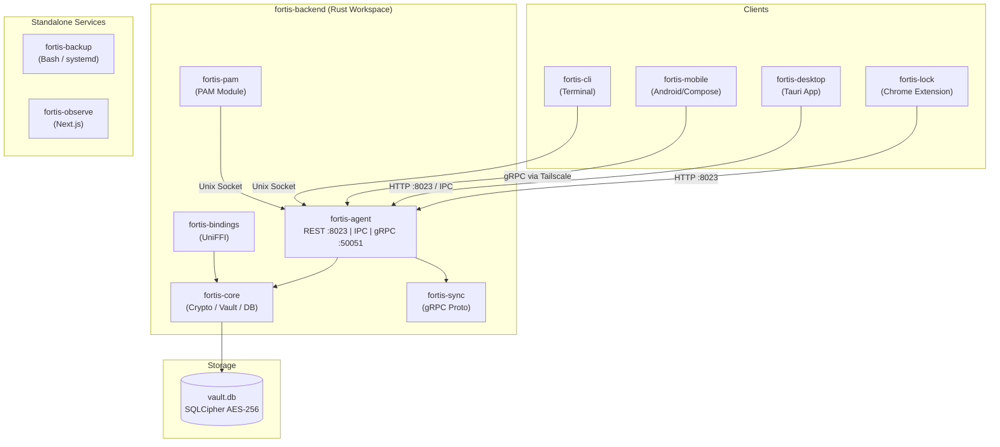

# Fortis Ecosystem

> A unified, privacy-first security platform. Password manager, authenticator, biometric sudo, encrypted backup, and browser privacy firewall — all in one cohesive system.

[](https://github.com/Fortis-Ecosystem)
[](https://tailscale.com)
[](https://github.com/ganeshak11)

---

## Architecture Overview



---

## Repositories

All repositories live under the [Fortis-Ecosystem](https://github.com/Fortis-Ecosystem) GitHub organization.

| Repository | Language | Description |
|---|---|---|
| [fortis-backend](https://github.com/Fortis-Ecosystem/fortis-backend) | Rust | Cargo workspace: agent daemon, core crypto library, gRPC sync, PAM module, UniFFI bindings |
| [fortis-cli](https://github.com/Fortis-Ecosystem/fortis-cli) | Rust | Command-line interface for interacting with the agent daemon over IPC |
| [fortis-desktop](https://github.com/Fortis-Ecosystem/fortis-desktop) | TypeScript/Rust | Tauri v2 desktop application with glassmorphic UI |
| [fortis-mobile](https://github.com/Fortis-Ecosystem/fortis-mobile) | Kotlin | Android app (Jetpack Compose) — vault, authenticator, biometric auth |
| [fortis-lock](https://github.com/Fortis-Ecosystem/fortis-lock) | TypeScript/React | Chrome Manifest V3 extension — browser privacy firewall with biometric unlock |
| [fortis-backup](https://github.com/Fortis-Ecosystem/fortis-backup) | Bash | Incremental backup engine with hard-linked snapshots, systemd integration, and remote sync |
| [fortis-observe](https://github.com/Fortis-Ecosystem/fortis-observe) | TypeScript/Next.js | WebGL telemetry and visitor analytics platform (standalone, isolated) |
| [docs](https://github.com/Fortis-Ecosystem/docs) | Markdown | This repository — ecosystem-wide documentation |
| [.github](https://github.com/Fortis-Ecosystem/.github) | Markdown | GitHub organization profile |

---

## Quick Start

### Prerequisites

| Requirement | Version | Purpose |
|---|---|---|
| Rust | 1.80+ (edition 2024) | Backend, CLI, PAM module |
| Node.js | 20+ | Desktop app, Chrome extension |
| Android Studio | Latest | Mobile app |
| Tailscale | Latest | VPN mesh for mobile ↔ agent communication |

### 1. Clone and Build the Backend

```bash
git clone git@github.com:Fortis-Ecosystem/fortis-backend.git
cd fortis-backend

# Build all workspace crates
cargo build --release

# Set the API key
export FORTIS_AGENT_KEY=$(openssl rand -hex 32)
```

### 2. Start the Agent

```bash
RUST_LOG=info ./target/release/fortis-agent
```

The agent starts three transport servers:
- **REST API** on `0.0.0.0:8023` (Bearer token auth)
- **IPC Socket** at `/tmp/fortis_agent.sock` (owner-only permissions)
- **gRPC** on port `50051` (stub — planned for mobile biometric relay)

### 3. Use the CLI

```bash
git clone git@github.com:Fortis-Ecosystem/fortis-cli.git
cd fortis-cli
cargo build --release

./target/release/fortis-cli add "My Secret Note"
./target/release/fortis-cli get "My Secret Note"
./target/release/fortis-cli pair
```

### 4. Launch the Desktop App

```bash
git clone git@github.com:Fortis-Ecosystem/fortis-desktop.git
cd fortis-desktop
npm install
npm run tauri dev
```

> **Note:** The desktop app requires `fortis-backend/fortis-core` at `../../fortis-backend/fortis-core` relative to `src-tauri/`. Ensure the repos are cloned side-by-side in the same parent directory.

### 5. Load the Browser Extension

```bash
git clone git@github.com:Fortis-Ecosystem/fortis-lock.git
cd fortis-lock
npm install
npm run build
# Open chrome://extensions → Enable Developer Mode → Load Unpacked → select dist/
```

---

## Security Model

- **SQLCipher Vault Encryption** — AES-256 encrypted database with 256,000 KDF iterations
- **Argon2id Key Derivation** — Master password → 32-byte key via Argon2id (64 MB memory, 3 iterations)
- **ChaCha20-Poly1305** — Symmetric encryption for individual vault field values
- **Ed25519 Signatures** — Biometric challenge-response authentication between agent and mobile
- **Zero-Trust Pairing** — Devices exchange public keys with a single-use 6-digit OTP
- **Zeroized Memory** — All secrets wrapped in `zeroize::Zeroizing<String>`, wiped from RAM on drop
- **Bearer Token Auth** — REST API requires `Authorization: Bearer <FORTIS_AGENT_KEY>`
- **Socket Permissions** — IPC socket restricted to `chmod 0600` (owner-only)

---

## Documentation

| Guide | Description |
|---|---|
| [Installation Guide](./installation/README.md) | Full setup from scratch |
| [API Reference](./api/README.md) | REST, IPC, and gRPC endpoint documentation |
| [Architecture Guide](./architecture/README.md) | System design, data flow, component layers |
| [Security Model](./security/README.md) | Encryption, authentication, threat model |
| [Development Guide](./development/README.md) | Building, testing, contributing |
| [Deployment Guide](./deployment/README.md) | Production systemd, PAM, Tauri packaging |
| [Troubleshooting](./troubleshooting/README.md) | Common issues and debug commands |

---

## Recommended Directory Layout

For development, clone all repositories side-by-side:

```
~/dev/Fortis-Ecosystem/
├── fortis-backend/         # Rust workspace (agent, core, sync, bindings, pam)
├── fortis-cli/             # Rust CLI (standalone)
├── fortis-desktop/         # Tauri desktop app
├── fortis-mobile/          # Android Kotlin app
├── fortis-lock/            # Chrome privacy extension
├── fortis-backup/          # Bash backup engine
├── fortis-observe/         # Next.js analytics (standalone)
├── docs/                   # This documentation repo
└── archives/               # Legacy/archived code
```

> **Important:** `fortis-desktop/src-tauri/Cargo.toml` depends on `fortis-core` via a relative path (`../../fortis-backend/fortis-core`). This layout is required for the desktop app to build.

---

## Maintainer

**Ganesh Angadi**
- GitHub: [@ganeshak11](https://github.com/ganeshak11)
- Portfolio: [ganeshangadi.online](https://ganeshangadi.online)
- LinkedIn: [Ganesh Angadi](https://linkedin.com/in/ganeshangadi1301)
