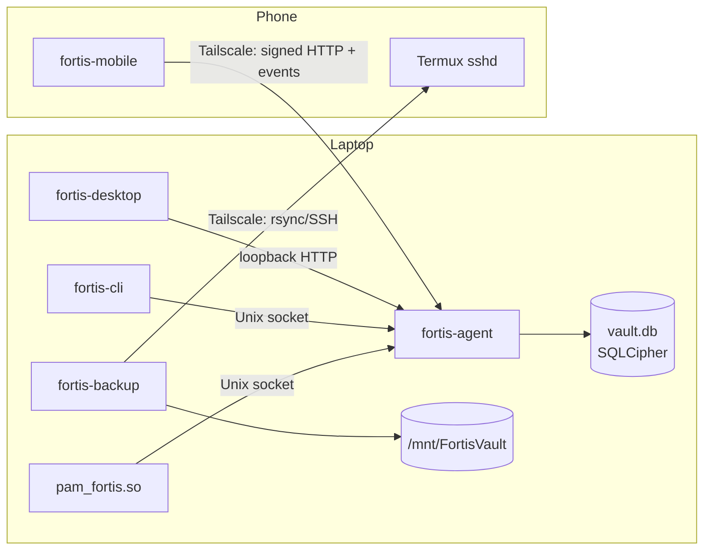

# Fortis Ecosystem

> A privacy-first system for **your Android phone and your Linux laptop(s)**: an encrypted password vault on both, TOTP codes, fingerprint-approved `sudo`, full laptop remote control, phone-as-webcam, and encrypted off-site backups — joined over Tailscale, with no cloud service in between.

[](https://tailscale.com)
[](https://github.com/ganeshak11)

**These documents are the specification.** Code is written to match them; when code and docs disagree, the docs win and the code gets fixed. Start with the [Security Model](./security/README.md).

---

## What Fortis does

| Feature | Laptop | Phone |
|---|---|---|
| Encrypted password vault | ✓ desktop app + CLI | ✓ own encrypted copy, synced |
| Password autofill + save | ✓ browser extension (Firefox, Chromium) | ✓ Android autofill (apps + browsers) |
| TOTP authenticator | ✓ | ✓ |
| Fingerprint-approved `sudo` | prompts | approves |
| Laptop remote (telemetry, lock/suspend/shutdown, media, volume, clipboard, files) | serves | controls (app + home-screen widget) |
| Remote keyboard & mouse | receives (off by default, fingerprint to start) | network or Bluetooth mode |
| Phone camera as webcam | `/dev/video10` (off by default) | streams |
| Notification mirroring | shows phone notifications | sends (off by default, per-app) |
| Camera-roll sync | `~/Pictures/FortisCameraRoll` | uploads new photos daily (off by default) |
| Backups (mirror + snapshots) | ✓ | receives off-site copy (Termux) |

There is deliberately **no remote shell** — use SSH over Tailscale.

## Architecture



Full detail: [Architecture](./architecture/README.md).

## Repositories

| Repository | Language | Contents |
|---|---|---|
| [fortis-backend](https://github.com/Fortis-Ecosystem/fortis-backend) | Rust | Workspace: `fortis-core`, `fortis-agent`, `fortis-pam`, `fortis-bindings` |
| [fortis-cli](https://github.com/Fortis-Ecosystem/fortis-cli) | Rust | Terminal client (IPC) |
| [fortis-desktop](https://github.com/Fortis-Ecosystem/fortis-desktop) | Rust + TypeScript | Tauri v2 vault app |
| [fortis-mobile](https://github.com/Fortis-Ecosystem/fortis-mobile) | Kotlin + Bash | Android app (`android/`) and Termux backup CLI (`cli/`) |
| fortis-browser | JS + Rust | Browser extension + native-messaging host |
| [fortis-backup](https://github.com/Fortis-Ecosystem/fortis-backup) | Bash | Backup engine + systemd timer |
| [docs](https://github.com/Fortis-Ecosystem/docs) | Markdown | This specification |

Not part of the ecosystem: `fortis-observe` (separate web-analytics project) and `fortis-lock` (dropped).

## Security at a glance

- Vault: SQLCipher + per-entry XChaCha20-Poly1305; keys from **Argon2id** (random per-vault salt) split with **HKDF**.
- Agent listens on **`127.0.0.1` and the Tailscale IP only** — never on the LAN.
- Desktop authenticates with a local token kept out of the webview; the phone **signs every request** with a hardware-backed P-256 key.
- `sudo` approvals are signed on the phone after a fingerprint and **verified by the PAM module against a root-owned key file** — a compromised user account can't fake one. Any failure falls back to the password prompt.
- Remote keyboard/mouse needs a fresh fingerprint to start and shows a desktop notification while active; webcam streams only over Tailscale with a one-time token.
- Auto-lock after 15 minutes idle; unlock back-off; no secrets in logs.

## Documentation

| Guide | Contents |
|---|---|
| [Security Model](./security/README.md) | Threat model, crypto, PAM design, permissions, audit checklist |
| [Architecture](./architecture/README.md) | Components, data model, data flows |
| [API Reference](./api/README.md) | REST, events WebSocket, IPC |
| [Installation](./installation/README.md) | Set everything up from scratch |
| [Deployment](./deployment/README.md) | systemd services, PAM install, packaging |
| [Development](./development/README.md) | Building, testing, contributing |
| [Troubleshooting](./troubleshooting/README.md) | Common problems |
| [Real-Device Test Plan](./testing/README.md) | Step-by-step checks on a real phone + laptop |

## Directory layout

Clone repositories side by side:

```text
~/dev/Fortis/Fortis-Ecosystem/
├── fortis-backend/
├── fortis-cli/
├── fortis-desktop/
├── fortis-mobile/
├── fortis-backup/
├── docs/
└── archives/        # old prototypes, not built
```

## Implementation status

The code is being brought in line with this specification. Status per area (updated as work lands):

| Area | Status |
|---|---|
| Vault crypto (Argon2id, HKDF, AAD, random salt) | **Done** in `fortis-core` (37 tests) |
| Agent listeners & auth (loopback/tailnet, token file, signatures) | **Done** — 127.0.0.1 + Tailscale IP only, `agent.token`, Host/Origin checks, signed requests with timestamp + nonce |
| Auto-lock, unlock back-off | **Done** (logind screen-lock signal not wired yet) |
| Vault CRUD + sync | **Done** — `fortis-core` + all agent vault and sync endpoints |
| IPC JSON protocol + peer-UID check | **Done** — `$XDG_RUNTIME_DIR/fortis/agent.sock`, root limited to `auth_request` / `pam_devices` |
| File confinement, action list | **Done** — `/proc`-based telemetry, fixed action list, root-confined files |
| Pairing + device store | **Done** (agent side) |
| `pam_fortis` + approvals + events stream | **Done** — module with lockout safeguards, two-stage install, tested through real libpam and the real sudo stack in a sandbox (not yet on real hardware with a phone) |
| fortis-cli | **Done** — all commands incl. `pair` (QR) and `sudo fortis pam-enroll` |
| fortis-desktop | **Done** — release build runs against the agent; unlock, entries, 2FA, copy/auto-clear, add/edit/delete, lock checked by hand |
| Notifications, sessions, remote input, webcam endpoints | **Done** (agent side; tested without real xdotool/ydotool/ffmpeg) |
| fortis-mobile app — screens (dashboard, control, files, monitor, widget, camera sync, notifications) | **Done** on the signed v2 API (phase 1) |
| fortis-mobile app — network remote input + phone webcam (phase 4) | **Done** — fingerprint-confirmed input session (session bytes checked against fortis-core); webcam server checked on the JVM incl. real `ffmpeg` pulling it with the agent's options. Remote input and webcam **verified on real hardware** (KDE Wayland via ydotool; phone camera → `/dev/video10` over Tailscale, wrong-token / second-viewer refused) |
| fortis-bindings (phone crypto API) | **Done** — key derivation, entry crypto, TOTP, canonical bytes, signature verify |
| fortis-mobile app — security (per-pairing P-256 keys, signed requests, phone vault, sudo prompts) | Keys, signed requests, pairing, the **phone vault** (sync round-trip verified against fortis-core's push rules) and **sudo prompts done** — events service, full-screen approval, fingerprint-signed answers; frame verification and approval bytes verified against fortis-core on the emulator; **verified on real hardware** (Infinix X6871 + Ubuntu laptop): `pam-test` approve/deny and real `sudo` |
| fortis-mobile app — terminal screen | **Removed** |
| fortis-mobile Termux CLI | Done |
| fortis-backup | Done |
| Autofill: shared matching rule (`fortis-core`) | Not started |
| Autofill: phone (Android Autofill service, fill + save) | Not started |
| Autofill: laptop (fortis-browser extension + host) | Not started |

## Maintainer

**Ganesh Angadi** — [GitHub](https://github.com/ganeshak11) · [Portfolio](https://ganeshangadi.online) · [LinkedIn](https://linkedin.com/in/ganeshangadi1301)
