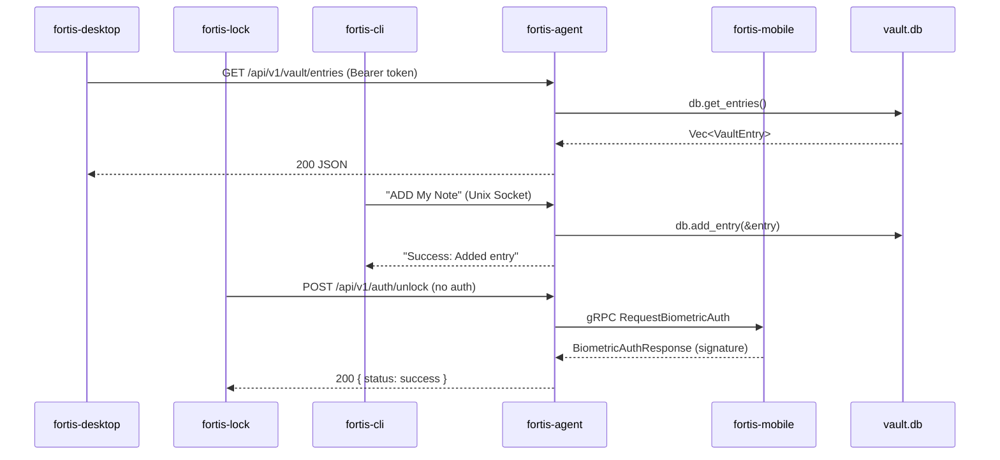

# Fortis Agent — API Reference

**Base URL:** `http://127.0.0.1:8023/api/v1`

---

## Authentication

All authenticated endpoints require the `Authorization` header:

```
Authorization: Bearer <FORTIS_AGENT_KEY>
```

The API key is set via the `FORTIS_AGENT_KEY` environment variable when starting the agent. If the variable is not set, the agent returns `500 Internal Server Error` for all authenticated requests.

Unauthenticated requests to protected endpoints return `401 Unauthorized`.

---

## REST API — Authenticated Endpoints

### GET `/telemetry`

Returns real-time system telemetry collected via shell commands (`top`, `free`, `df`, `sensors`).

**Response:**
```json
{
  "cpu": "12.5%",
  "mem_total": "16384 MB",
  "mem_used": "8192 MB",
  "swap_total": "8192 MB",
  "swap_used": "1024 MB",
  "storage_total": "500G",
  "storage_used": "200G",
  "temp": "52.0°C",
  "uptime": "up 3 hours, 42 minutes"
}
```

> **Note:** Temperature reading tries `sensors` output for `Tctl` first, then falls back to `CPU:` label.

---

### GET `/capabilities`

Returns the agent's enabled feature flags.

**Response:**
```json
{
  "telemetry": true,
  "actions": true,
  "files": true,
  "vault": true,
  "biometric_auth": true,
  "backup": true,
  "terminal": true,
  "clipboard": true,
  "webcam": true,
  "media": true
}
```

---

### POST `/clipboard`

Copies text to the system clipboard. Uses `wl-copy` on Wayland or `xclip -selection clipboard` on X11.

**Request Body:** Raw text bytes (not JSON).

**Response:**
```json
{
  "status": "success",
  "message": "Clipboard updated"
}
```

---

### POST `/action`

Executes a system action.

**Request Body:**
```json
{
  "action": "lock_screen"
}
```

**Available Actions:**

| Action | Implementation | Notes |
|---|---|---|
| `lock_screen` | `loginctl lock-session` | |
| `run_backup` | Spawns `fortis-backup.sh` | Path is hardcoded in source |
| `media_play_pause` | `playerctl play-pause` | Requires `playerctl` |
| `media_next` | `playerctl next` | |
| `media_prev` | `playerctl previous` | |
| `volume_up` | `amixer -D pulse sset Master 5%+` | Returns current volume |
| `volume_down` | `amixer -D pulse sset Master 5%-` | Returns current volume |
| `suspend` | `systemctl suspend` | |
| `shutdown` | `systemctl poweroff` | |

**Response:**
```json
{
  "status": "success",
  "action": "lock_screen"
}
```

For volume actions, the response includes the current volume level:
```json
{
  "status": "success",
  "action": "volume_up",
  "volume": "75%"
}
```

**Errors:**
- `400 Bad Request` — Unknown action string.

---

### GET `/media`

Returns currently playing media metadata via `playerctl metadata`.

**Response:**
```json
{
  "title": "Bohemian Rhapsody",
  "artist": "Queen",
  "album": "A Night at the Opera",
  "position": "120000000",
  "length": "354000000",
  "status": "Playing",
  "player": "spotify"
}
```

**Errors:**
- `404 Not Found` — No active media player detected.

---

### POST `/files/drop`

Upload a file via multipart form data. Files are saved to `~/Downloads/FortisMobileDrop/`.

**Request:** `Content-Type: multipart/form-data` with a field named `file`.

**Response:**
```json
{
  "status": "success",
  "file": "document.pdf"
}
```

**Errors:**
- `400 Bad Request` — No `file` field found in the multipart body.
- `500 Internal Server Error` — Failed to write file to disk.

---

### POST `/files/list`

List contents of a directory on the host machine.

**Request Body:**
```json
{
  "path": "/home/user/Documents"
}
```

If `path` is `null` or empty, defaults to `$HOME`.

**Response:**
```json
{
  "path": "/home/user/Documents",
  "files": [
    { "name": "report.pdf", "size": 1234567, "is_dir": false },
    { "name": "photos", "size": 0, "is_dir": true }
  ]
}
```

---

### GET `/files/download?path=<filepath>`

Download a file from the host. Returns the file as a binary stream with a `Content-Disposition: attachment` header.

**Query Parameter:** `path` — Absolute path to the file.

**Errors:**
- `404 Not Found` — File does not exist or is a directory.

---

### GET `/backup/logs`

Returns the last 50 lines of the backup mirror log at `/mnt/FortisVault/Logs/mirror/mirror.log` as plain text.

**Errors:**
- `500 Internal Server Error` — Log file not found or unreadable.

---

### GET `/vault/entries`

Returns all vault entries from the SQLCipher database at `~/.local/share/fortis/vault.db`.

> **Note:** The database is opened with a hardcoded development key (`dev_master_key`) in the current implementation.

**Response:**
```json
[
  {
    "id": "550e8400-e29b-41d4-a716-446655440000",
    "folder_id": null,
    "title": "GitHub",
    "entry_type": {
      "Login": {
        "username": "user@example.com",
        "password": "s3cur3pass",
        "url": "https://github.com",
        "totp_secret": null
      }
    },
    "custom_fields": [],
    "notes": "My GitHub account"
  }
]
```

---

### POST `/vault/entries`

Create a new vault entry.

**Request Body:**
```json
{
  "title": "GitHub",
  "notes": "Work account",
  "entry_type": "Login",
  "username": "user@example.com",
  "password": "s3cur3pass",
  "totp_secret": "JBSWY3DPEHPK3PXP"
}
```

**Entry Types:**

| Type | Additional Fields |
|---|---|
| `Login` | `username` (optional), `password` (optional), `totp_secret` (optional) |
| `CreditCard` | Created with empty placeholder fields |
| `SecureNote` (default) | `notes` field is used as the secure content |

**Response:**
```json
{
  "status": "success"
}
```

---

## REST API — Public Endpoints (No Authentication)

### POST `/pair`

Accept a device pairing request. Validates the 6-digit code against the currently active pairing code (generated via `fortis-cli pair` or the IPC `PAIR_START` command).

**Request Body:**
```json
{
  "code": "482-916",
  "public_key": "hex_encoded_ed25519_public_key"
}
```

On success, the device's public key is stored in `~/.config/fortis/paired_devices.json`.

**Success Response:**
```json
{
  "status": "success",
  "message": "Paired successfully."
}
```

**Errors:**
- `401 Unauthorized` — Code is invalid, expired, or no active pairing session.

---

### POST `/auth/unlock`

Request biometric unlock. Used by the `fortis-lock` browser extension. The agent relays a biometric challenge to the paired mobile device via gRPC.

**Request Body:**
```json
{
  "domain": "reddit.com"
}
```

**Success Response (biometric approved):**
```json
{
  "status": "success"
}
```

**Errors:**
- `401 Unauthorized` — Biometric authentication was denied or failed.

> **Note (current behavior):** If the gRPC connection to the mobile device fails, the agent returns a mock `AUTH_SUCCESS` for development purposes. This will be removed in production.

---

## IPC Protocol (Unix Domain Socket)

**Socket Path:** `/tmp/fortis_agent.sock`
**Permissions:** `0600` (owner-only read/write)

The agent listens for text-based commands on the Unix socket. Each connection can send multiple commands.

| IPC Command | Description | Notes |
|---|---|---|
| `ADD <title>` | Create a SecureNote vault entry with the given title | Content: `"Encrypted secret note via IPC"` |
| `GET` | List all vault entries | Returns debug-formatted entry list |
| `SYNC` | Start P2P sync | **Stub** — returns static message |
| `AUTH_CHALLENGE` | Send biometric auth challenge to paired mobile | Relays via gRPC; mock fallback in dev |
| `PAIR_START` | Generate a 6-digit pairing code | Code format: `XXX-XXX` |

> **Note:** The IPC server initializes its own database connection and schema on startup, independent of the REST server.

**Example (using socat):**
```bash
echo "ADD My Secret" | socat - UNIX-CONNECT:/tmp/fortis_agent.sock
echo "GET" | socat - UNIX-CONNECT:/tmp/fortis_agent.sock
```

---

## gRPC Services

**Port:** `50051` (default in config)

> **⚠️ Current Status:** The gRPC transport server in `fortis-agent` is a **stub** — it starts but performs no operations. The gRPC service definitions exist in `fortis-sync` and the client code exists in `fortis-agent/src/modules/auth.rs`, but the server-side listener is not yet implemented.

### Proto Definitions

The protobuf file is located at `fortis-sync/proto/sync.proto` within the [fortis-backend](https://github.com/Fortis-Ecosystem/fortis-backend) repository.

#### SyncService

```protobuf
service SyncService {
    rpc Handshake (DeviceAuth) returns (Challenge);
    rpc ExchangeClocks (VectorClock) returns (Delta);
    rpc PushEntries (EncryptedBatch) returns (Ack);
    rpc PullEntries (SinceTimestamp) returns (EncryptedBatch);
}
```

#### FortisAuth

Used for biometric authentication relay between agent and mobile.

```protobuf
service FortisAuth {
    rpc RequestBiometricAuth (BiometricAuthRequest) returns (BiometricAuthResponse);
}

message BiometricAuthRequest {
    string nonce = 1;
    uint64 timestamp = 2;
    string device_name = 3;
    string requested_action = 4;
}

message BiometricAuthResponse {
    bool approved = 1;
    string signature = 2;  // Hex-encoded Ed25519 signature
}
```

---

## Communication Summary


