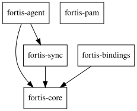
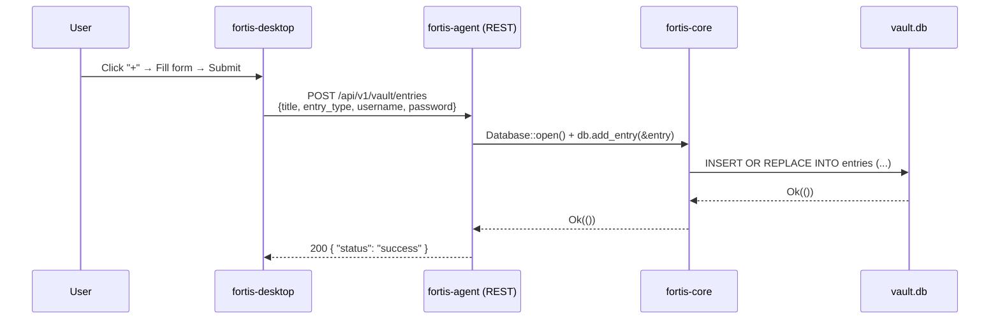
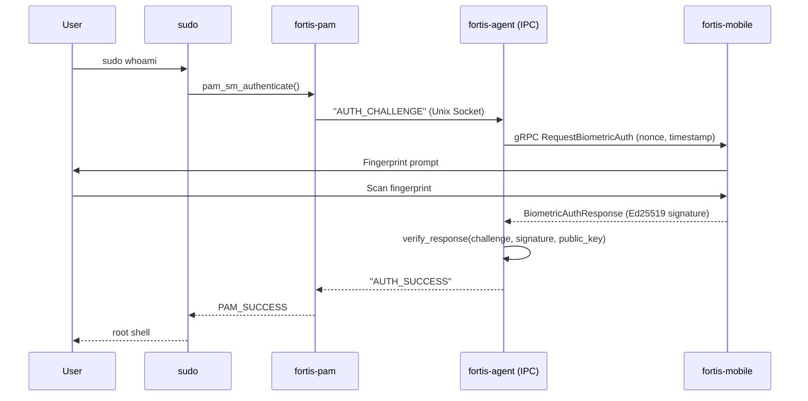
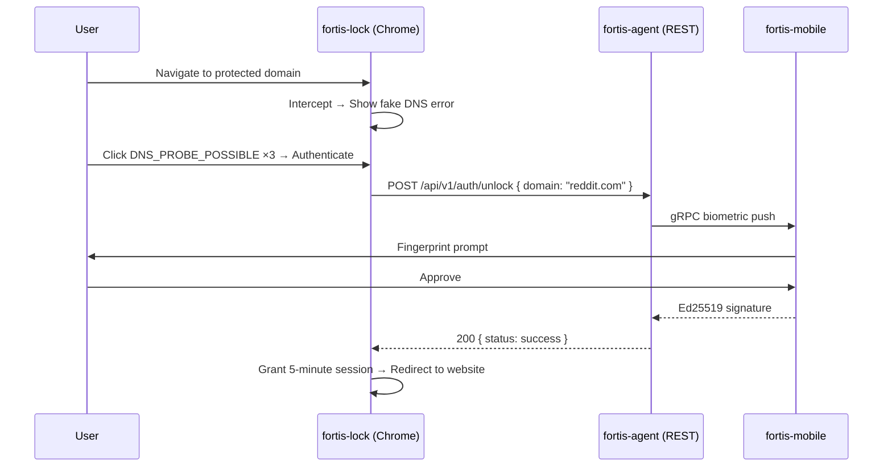

# Fortis Ecosystem — Architecture Guide

## System Architecture

The Fortis Ecosystem follows a **hub-and-spoke architecture** with `fortis-agent` as the central hub. All client applications communicate through the agent, which manages vault storage, system actions, and biometric authentication.

  

## Workspace Dependency Graph

The `fortis-backend` Rust workspace features multiple interlocking crates. The graph below maps these internal dependencies.

  

---

## Component Layers

### Layer 1: Core Library — `fortis-core`

The foundation. Contains no I/O or networking — pure cryptographic logic and data models. Lives in the [fortis-backend](https://github.com/Fortis-Ecosystem/fortis-backend) workspace.

| Module | Responsibility |
|---|---|
| `vault/mod.rs` | Data models: `VaultEntry`, `EntryType` (Login, Identity, CreditCard, SecureNote), `SecretString`, `CustomField`, `Vault`, `VaultFolder` |
| `db/mod.rs` | SQLCipher database: `Database::open()`, `init_schema()`, `add_entry()`, `get_entries()` |
| `auth/mod.rs` | `AuthChallenge::new()`, `verify_response()`, Ed25519 signature verification |
| `crypto/mod.rs` | `derive_master_key()` (Argon2id), `generate_vault_key()`, `encrypt_entry()` / `decrypt_entry()` (XChaCha20-Poly1305) |
| `totp.rs` | `generate_totp_code()` — RFC 6238 TOTP, SHA-1, 6 digits, 30-second period |
| `password_gen.rs` | `PasswordGenerator` — configurable length, uppercase, numbers, symbols |
| `sync/crdt.rs` | `SyncEngine` — Automerge CRDT wrapper for conflict-free vault merging (minimal, WIP) |

### Layer 2: Transport Protocol — `fortis-sync`

Defines the gRPC protocol used between the agent and mobile devices. Also in the [fortis-backend](https://github.com/Fortis-Ecosystem/fortis-backend) workspace.

| Component | Responsibility |
|---|---|
| `proto/sync.proto` | Protobuf definitions for `SyncService` (vault sync) and `FortisAuth` (biometric relay) |
| `build.rs` | Compiles `.proto` → Rust via `tonic-build` with vendored `protoc` |
| `src/server.rs` | `FortisSyncService` — stub implementation of `SyncService` RPCs |
| `src/client.rs` | `FortisSyncClient` — gRPC client for connecting to peers |
| `src/discovery.rs` | `PeerDiscovery` — planned Tailscale local API integration (returns hardcoded localhost) |

### Layer 3: Agent Daemon — `fortis-agent`

The central hub. Runs as a background daemon and exposes three transport interfaces. Also in [fortis-backend](https://github.com/Fortis-Ecosystem/fortis-backend).

| Transport | Port/Path | Protocol | Clients | Status |
|---|---|---|---|---|
| REST | `:8023` | HTTP/JSON (Axum) | Desktop, Browser Extension, Mobile | ✅ Active |
| IPC | `/tmp/fortis_agent.sock` | Unix Domain Socket | CLI, PAM | ✅ Active |
| gRPC | `:50051` | Protobuf (Tonic) | Mobile | ⚠️ Stub |

**Agent Modules:**

| Module | Purpose |
|---|---|
| `telemetry.rs` | Collects CPU, memory, swap, storage, temperature via shell commands |
| `actions.rs` | Executes system actions: lock, suspend, shutdown, media control, clipboard |
| `files.rs` | File listing, file drop (upload to `~/Downloads/FortisMobileDrop/`), file download |
| `vault.rs` | `VaultManager` — wraps `fortis-core::db::Database` with async mutex |
| `backup.rs` | Reads last 50 lines of backup log from `/mnt/FortisVault/Logs/mirror/mirror.log` |
| `auth.rs` | Pairing code generation, biometric challenge relay via gRPC client |

### Layer 4: Client Applications

| Client | Repository | Platform | Transport | Auth Method |
|---|---|---|---|---|
| [fortis-desktop](https://github.com/Fortis-Ecosystem/fortis-desktop) | Tauri v2 | Linux/macOS/Windows | REST (HTTP) + Direct DB | Bearer Token + env var / `~/.config/fortis/env` |
| [fortis-lock](https://github.com/Fortis-Ecosystem/fortis-lock) | Chrome Ext | Chrome MV3 | REST (HTTP) | Unauthenticated (public endpoints only) |
| [fortis-cli](https://github.com/Fortis-Ecosystem/fortis-cli) | Standalone | Terminal | IPC (Unix Socket) | Process-level (socket `0600` permissions) |
| [fortis-mobile](https://github.com/Fortis-Ecosystem/fortis-mobile) | Android | Kotlin/Compose | gRPC (planned) / REST | Ed25519 Signature |

### Layer 5: System Integration

| Component | Repository | Role |
|---|---|---|
| `fortis-pam` | [fortis-backend](https://github.com/Fortis-Ecosystem/fortis-backend) | Linux PAM module: sends `AUTH_CHALLENGE` over IPC socket for biometric sudo |
| `fortis-bindings` | [fortis-backend](https://github.com/Fortis-Ecosystem/fortis-backend) | UniFFI bindings: exports `get_totp()` and `generate_secure_password()` for mobile |
| [fortis-backup](https://github.com/Fortis-Ecosystem/fortis-backup) | Standalone | Incremental rsync-based backup with systemd timer |

---

## Data Flow Diagrams

### Adding a Vault Entry (Desktop → Agent → Database)

### Biometric Sudo (PAM → Agent → Mobile)

> **Note:** If the gRPC connection to mobile fails, the current development build returns a mock `AUTH_SUCCESS`. In production, it will return `AUTH_FAILURE` and PAM falls back to password authentication (`PamError::IGNORE`).

### Browser Unlock (FortisLock → Agent → Mobile)

---

## Security Boundaries

| Boundary | Protection |
|---|---|
| Vault at rest | AES-256 via SQLCipher + 256,000 KDF iterations |
| Vault field encryption | XChaCha20-Poly1305 (in `crypto/mod.rs`) |
| Master key derivation | Argon2id (64 MB memory, 3 passes, 4 lanes) |
| Vault in memory | `zeroize` crate wipes secrets on drop |
| REST API | Bearer token authentication |
| IPC socket | `chmod 0600` — owner-only access |
| gRPC channel | Tailscale WireGuard VPN encryption |
| Mobile keys | Android Hardware Keystore (non-exportable) |
| Config files | `chmod 0600` on `paired_devices.json` and `backup.conf` |
| PAM module | Falls back to `IGNORE` (password prompt) on any failure |
| Backup drive | `chmod 700` enforced on every run |

---

## Technology Stack

| Category | Technology |
|---|---|
| Core Language | Rust (edition 2024) |
| HTTP Framework | Axum 0.8 |
| Async Runtime | Tokio |
| gRPC | Tonic 0.11 + Prost 0.12 |
| Database | SQLCipher 4.x (via `rusqlite` with `bundled-sqlcipher`) |
| Encryption | XChaCha20-Poly1305, Argon2id, Ed25519 (`ed25519-dalek`) |
| Sync | Automerge CRDT (WIP) |
| Desktop | Tauri v2 + Vite + TypeScript |
| Mobile | Kotlin + Jetpack Compose |
| Browser Extension | React 19 + Vite + Chrome Manifest V3 + `@crxjs/vite-plugin` |
| Backup | Bash + rsync + systemd timers |
| Analytics | Next.js 16 + Supabase + TailwindCSS + react-globe.gl |
| VPN | Tailscale (WireGuard) |
| FFI | UniFFI 0.27 (Mozilla) |
| PAM | `pamsm` crate |
