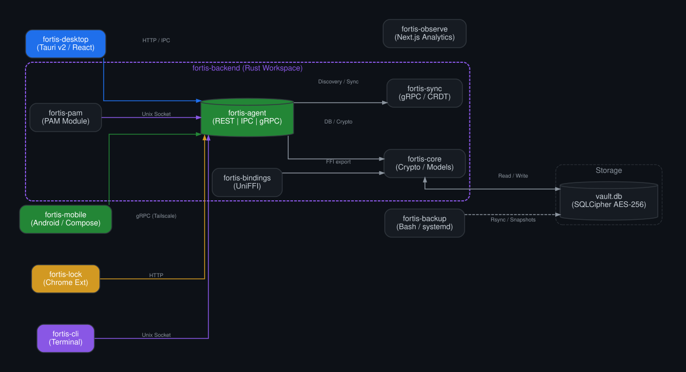
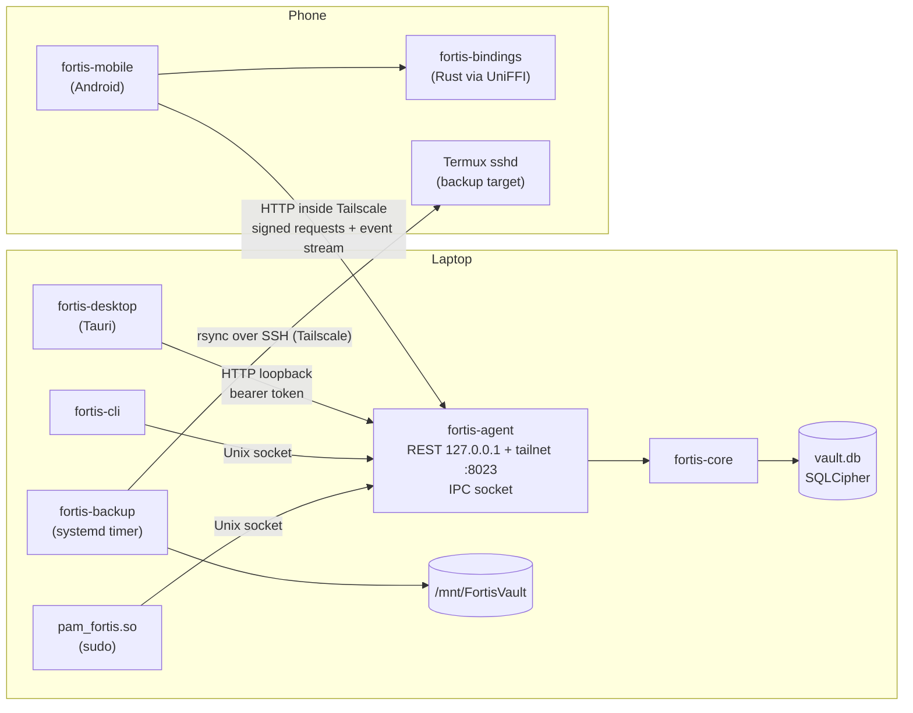
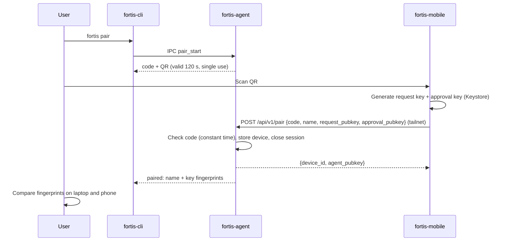
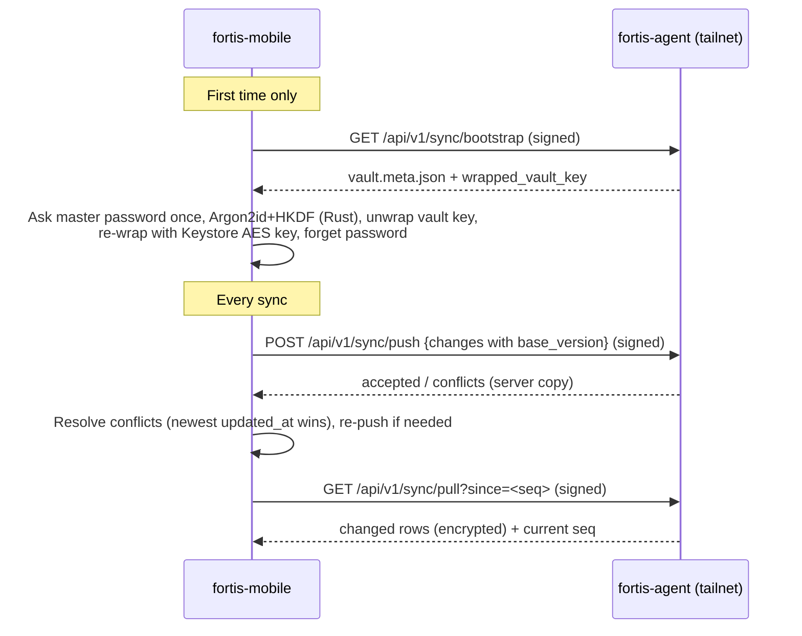
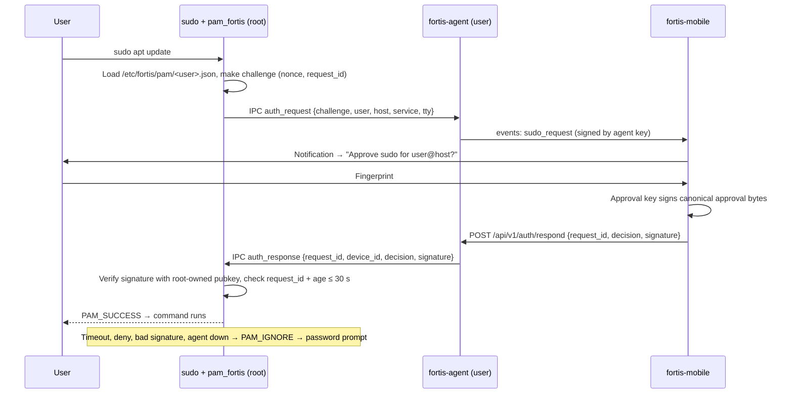
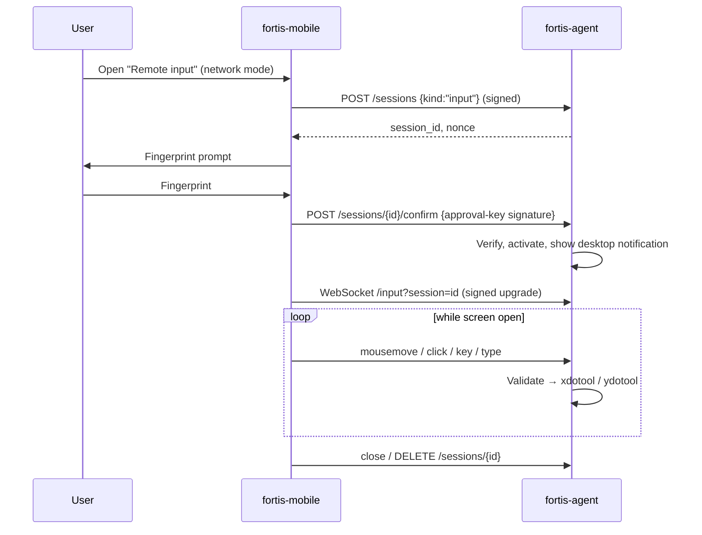

# Fortis Ecosystem — Architecture

This is the **architecture specification**. Security rules referenced here (§n) live in the [Security Model](../security/README.md); wire formats live in the [API Reference](../api/README.md).

---

## 1. System Overview

Fortis joins **your Android phone** and **your Linux laptop** (or several laptops) over **Tailscale**.

<div align="center">
  
</div>



### Components

| Component | Repo | Language | Role |
|---|---|---|---|
| `fortis-core` | fortis-backend | Rust lib | Crypto, data models, vault database, TOTP, password generator, signature verification. No networking. |
| `fortis-agent` | fortis-backend | Rust bin | The laptop daemon. Owns the vault, exposes REST + IPC, relays sudo approvals, serves files/telemetry/actions to the phone. |
| `pam_fortis` | fortis-backend (`fortis-pam`) | Rust cdylib | PAM module for biometric `sudo`. Verifies approvals itself. |
| `fortis-bindings` | fortis-backend | Rust cdylib (UniFFI) | Exposes `fortis-core` crypto + TOTP to the Android app. |
| `fortis-cli` | fortis-cli | Rust bin | Terminal client over the IPC socket. Also `pam-enroll`. |
| `fortis-desktop` | fortis-desktop | Tauri v2 (Rust + TS) | Desktop vault UI. Talks to the agent only from its Rust side. |
| `fortis-mobile` (app) | fortis-mobile (`android/`) | Kotlin / Compose | Phone vault, TOTP, sudo approvals, laptop remote, phone-as-webcam, Bluetooth keyboard/mouse, notification mirroring, camera-roll sync, home-screen widget. |
| `fortis-mobile` (Termux CLI) | fortis-mobile (`cli/`) | Bash | Runs in Termux; starts/stops the phone's `sshd` for backups and reports readiness to `fortis-backup` (`status --json`, `start`, `stop`). |
| `fortis-backup` | fortis-backup | Bash + systemd | Mirror + hard-linked snapshots + off-site push to the phone. Independent of the agent. |

Out of scope: `fortis-observe` (separate analytics project), `fortis-lock` (dropped).

### Design rules

1. **One daemon owns the vault.** Only `fortis-agent` opens `vault.db` on the laptop. The desktop app, CLI and PAM module never touch the file.
2. **Plain HTTP + WebSocket, inside Tailscale.** No gRPC. Tailscale provides transport encryption; Fortis adds request signing on top.
3. **The phone holds its own encrypted copy** of the vault and syncs entry by entry. It never receives the plaintext vault key or master password over the network.
4. **Root decisions are made by root.** `pam_fortis` verifies phone signatures against a root-owned key file; the agent is only a relay.
5. **Fail closed for access, fail open to the password prompt.** Any Fortis error denies access through Fortis but never blocks the normal `sudo` password.
6. **Powerful features need a fingerprint and are off by default.** Remote keyboard/mouse and the webcam must be enabled in `agent.toml`; remote input also needs a fingerprint-confirmed session. There is no remote shell.
7. **One phone, one or more laptops.** The phone can pair with several laptops for remote control and sudo approval; exactly one of them is its **vault laptop** for password sync.

---

## 2. Rust Workspace (`fortis-backend`)

```text
fortis-backend/
├── Cargo.toml              # workspace: fortis-core, fortis-agent, fortis-pam, fortis-bindings
├── fortis-core/
│   └── src/
│       ├── lib.rs
│       ├── crypto.rs       # Argon2id, HKDF, XChaCha20-Poly1305, key types
│       ├── vault.rs        # VaultEntry, EntryType, SecretString, CustomField
│       ├── db.rs           # VaultDb: create/open/rekey, entries CRUD, sync queries  (feature "db")
│       ├── meta.rs         # vault.meta.json read/write
│       ├── sign.rs         # P-256 verify, canonical request / approval bytes
│       ├── totp.rs
│       └── password_gen.rs
├── fortis-agent/
│   └── src/
│       ├── main.rs         # start-up, config, permission checks, signal handling
│       ├── config.rs       # ~/.config/fortis/agent.toml
│       ├── state.rs        # VaultState (locked/unlocked), auto-lock timer
│       ├── devices.rs      # paired_devices.json, pairing sessions
│       ├── approvals.rs    # pending sudo requests, relay to phones
│       ├── transport/
│       │   ├── rest.rs     # router, loopback + tailnet listeners
│       │   ├── auth.rs     # bearer check, device-signature check, Host/Origin checks
│       │   ├── events.rs   # /api/v1/events WebSocket
│       │   └── ipc.rs      # JSON-lines Unix socket, SO_PEERCRED
│       └── modules/
│           ├── vault.rs    # entry CRUD, sync
│           ├── telemetry.rs
│           ├── actions.rs
│           ├── files.rs    # root-confined list/download/drop
│           ├── backup.rs
│           ├── notify.rs   # mirrored phone notifications → notify-send
│           ├── sessions.rs # fingerprint-confirmed sessions
│           ├── input.rs    # xdotool / ydotool backend for remote input
│           └── webcam.rs   # ffmpeg → v4l2loopback
├── fortis-pam/
│   └── src/lib.rs          # pam_sm_authenticate → PAM_SUCCESS | PAM_IGNORE
└── fortis-bindings/
    └── src/lib.rs          # UniFFI exports
```

<div align="center">
  
</div>

Dependency rules:

- `fortis-core` has the `db` feature (SQLCipher). `fortis-agent` enables it; `fortis-bindings` and `fortis-pam` do not.
- `fortis-pam` depends on `fortis-core` (no `db`) for `sign.rs` only. It has no async runtime and no logging to stdout.
- `fortis-desktop` and `fortis-cli` do **not** depend on `fortis-core`'s `db` feature. `fortis-cli` may depend on `fortis-core` (no `db`) for the password generator.

---

## 3. fortis-agent

### 3.1 Lifecycle

1. Load `~/.config/fortis/agent.toml` (create defaults if missing).
2. Create / tighten directories and files per security §7.1. Generate `agent.token` and `agent.key` if missing.
3. Start in **locked** state. If `vault.meta.json` doesn't exist the vault is **uninitialised** (`POST /vault/init` creates it).
4. Start listeners: IPC socket, loopback REST, tailnet REST (if enabled and a Tailscale IP exists; retried every 30 s if Tailscale isn't up yet).
5. On `SIGTERM`: lock the vault, close listeners, remove the socket, exit 0.

Runs as a **systemd user service** (`systemctl --user`), one per user.

### 3.2 Configuration (`~/.config/fortis/agent.toml`)

```toml
[rest]
port = 8023            # used on loopback and tailnet
tailnet = true         # also listen on the Tailscale IPv4 address

[vault]
auto_lock_minutes = 15

[auth]
approval_timeout_secs = 30

[files]
roots = ["~/Downloads", "~/Documents"]
max_upload_mb = 100
camera_dir = "~/Pictures/FortisCameraRoll"

[input]
enabled = false        # remote keyboard/mouse over the network

[webcam]
enabled = false        # phone camera → v4l2loopback
device = "/dev/video10"

[backup]
script = "~/dev/Fortis/Fortis-Ecosystem/fortis-backup/fortis-backup.sh"
log    = "/mnt/FortisVault/Logs/mirror/mirror.log"
```

Unknown keys are an error (the agent refuses to start and logs which key).

### 3.3 State

```text
          init (password)                  unlock (password)
uninitialised ───────────────► unlocked ◄──────────────────── locked
                                   │  lock / idle timeout / SIGTERM   ▲
                                   └──────────────────────────────────┘
```

- Telemetry, actions, files, backup logs, events and pairing work in every state.
- Vault and sync endpoints need **unlocked**.
- Any vault request resets the idle timer.

### 3.4 Modules

| Module | Responsibility |
|---|---|
| `vault` | Create/unlock/lock, entry CRUD, password change, sync push/pull |
| `telemetry` | CPU, memory, swap, disk, temperature, uptime — read from `/proc` and `/sys` (no shelling out to `top`/`free`) |
| `actions` | Fixed list of system actions (lock screen, suspend, shutdown, media, volume, clipboard, run backup) |
| `files` | List / download inside configured roots; receive drops into `~/Downloads/FortisMobileDrop/` |
| `backup` | Tail of the backup log; trigger a backup run |
| `devices` | Pairing sessions, paired device store, revocation |
| `approvals` | Pending sudo requests from IPC, fan-out to phones via events, relay replies back |
| `notify` | Show mirrored phone notifications with `notify-send` |
| `sessions` | Create, confirm, expire fingerprint-confirmed sessions; desktop notification while active |
| `input` | Remote keyboard/mouse via `xdotool` (X11) or `ydotool` (Wayland) |
| `webcam` | Run `ffmpeg` to pull the phone's stream into a `v4l2loopback` device |

---

## 4. Data Model

### 4.1 Vault entry (plaintext, inside the ciphertext)

```rust
struct VaultEntry {
    id: Uuid,
    folder: Option<String>,
    title: String,
    entry_type: EntryType,
    custom_fields: Vec<CustomField>,
    notes: SecretString,
    created_at: i64,      // unix seconds
    updated_at: i64,
}

enum EntryType {
    Login      { username: String, password: SecretString, urls: Vec<String>, totp: Option<TotpConfig> },
    CreditCard { cardholder_name: String, number: SecretString, exp_month: u8, exp_year: u16, cvv: SecretString },
    Identity   { first_name: String, last_name: String, email: Option<String>, phone: Option<String>, address: Option<String> },
    SecureNote { content: SecretString },
    Totp       { issuer: Option<String>, account: Option<String>, totp: TotpConfig },
}

struct TotpConfig { secret_base32: SecretString, digits: u8 /*6*/, period: u32 /*30*/, algorithm: TotpAlg /*Sha1*/ }
```

A standalone authenticator item is `EntryType::Totp`; a login that also has 2FA uses `Login.totp`.

### 4.2 Database schema (`vault.db`)

```sql
CREATE TABLE metadata (
    key   TEXT PRIMARY KEY,           -- 'schema_version', 'wrapped_vault_key', 'vault_id', 'sync_seq'
    value BLOB NOT NULL
);

CREATE TABLE entries (
    id             BLOB PRIMARY KEY,  -- 16-byte UUID
    version        INTEGER NOT NULL,  -- writer-incremented, bound into AAD
    seq            INTEGER NOT NULL,  -- agent-assigned change sequence (for sync pulls)
    updated_at     INTEGER NOT NULL,  -- unix seconds, copied from the entry
    deleted        INTEGER NOT NULL DEFAULT 0,  -- tombstone; encrypted_data is then empty
    encrypted_data BLOB NOT NULL
);
CREATE INDEX entries_seq ON entries(seq);
```

No folder table: folders are a string inside each entry. Tombstones are kept so deletions sync.

---

## 5. Data Flows

### 5.1 Desktop unlock and read

```mermaid
sequenceDiagram
    participant UI as Desktop webview
    participant TR as Desktop Rust backend
    participant A as fortis-agent (loopback)
    participant DB as vault.db

    UI->>TR: invoke("unlock", password)
    TR->>A: POST /api/v1/vault/unlock (Bearer token from agent.token)
    A->>A: Argon2id → HKDF → db key, wrap key
    A->>DB: PRAGMA key; read wrapped_vault_key
    A->>A: unwrap vault key, zeroise master/db/wrap keys
    A-->>TR: 200 {state:"unlocked"}
    TR-->>UI: ok
    UI->>TR: invoke("list_entries")
    TR->>A: GET /api/v1/vault/entries
    A-->>TR: 200 [entry summaries]
    TR-->>UI: entries (no token ever reaches JS)
```

### 5.2 Pairing a phone



### 5.3 Phone vault sync



The agent must be **unlocked** to sync (it needs the db key to read/write `vault.db`). The phone shows "Laptop vault locked" otherwise.

### 5.4 Biometric sudo



**How the phone receives requests without Google services:** when paired, the app runs a foreground service (persistent low-priority notification "Fortis connected") that keeps the `/api/v1/events` WebSocket open over Tailscale and reconnects with back-off. A sudo request raises a high-priority, full-screen notification.

### 5.5 Laptop remote (phone → laptop)

Telemetry, actions, media, clipboard, files, backup trigger and log: signed `GET`/`POST` requests on the tailnet listener. The home-screen widget (Lock laptop, Back up now) sends the same signed `POST /actions` requests. See API reference.

### 5.6 Remote keyboard and mouse



**Bluetooth mode** needs no agent: the phone registers as a Bluetooth HID keyboard/mouse (`BluetoothHidDevice`) and the laptop pairs with it like any keyboard. It works even when the laptop's network or agent is down.

### 5.7 Phone camera as webcam

1. Phone opens the camera (CameraX) and starts an MJPEG server on its **Tailscale IP**, random port, random token in the URL.
2. Phone: `POST /webcam/start {port, token}`.
3. Agent runs `ffmpeg` to read `http://<phone>:<port>/<token>/stream` into `/dev/video10` (`v4l2loopback`). Video-call apps see it as a normal webcam.
4. Leaving the screen, `POST /webcam/stop`, a dropped stream, or 1 hour stops both sides.

### 5.8 Phone → laptop data

- **Notification mirroring:** an Android `NotificationListenerService` sends allow-listed apps' notifications to `POST /notify`; the laptop shows them as desktop notifications.
- **Camera-roll sync:** a daily WorkManager job uploads new photos to `POST /files/drop?dest=camera` (unmetered network only).
- **Send file / clipboard:** manual, from the Files and Dashboard screens.

### 5.9 Backup

`fortis-backup` is a separate systemd timer job (daily 23:45, `Persistent=true`):

1. **Mirror** sources (Projects, Secrets, Memories) to `/mnt/FortisVault/Mirror` with `rsync --delete`.
2. **Snapshot** daily (Projects, Secrets) and weekly on Sundays (Memories) with `--link-dest` hard links. Skipped if mirror success < 95 %.
3. **Retention:** daily 14 days, weekly 56 days.
4. **Off-site push** of today's snapshot to the phone's Termux `sshd` over Tailscale, with a strict known-hosts file and a dedicated key (`~/.ssh/fortis_mobile`). Remote retention 7 days.

The vault file is included by listing `~/.local/share/fortis` under `SECRETS` in `backup.conf`. It stays encrypted in the backup. The agent can trigger a run (`run_backup` action) and read the log tail.

The phone side of backup is the Termux CLI in `fortis-mobile/cli/`, separate from the Android app:

| Command | Purpose |
|---|---|
| `fortis-mobile start` | Start backup mode: `sshd`, wake lock, notification |
| `fortis-mobile stop` | Stop `sshd`, release wake lock, clear notification |
| `fortis-mobile status [--json]` | Battery, free storage, Tailscale reachable, `sshd` running → `{"ready": bool, "reason": …}` |
| `fortis-mobile health` | Exit 0 if ready |
| `fortis-mobile logs` / `version` | Session log / version |

`fortis-backup` waits up to 5 minutes for `status --json` to report `ready`, pushes the snapshot, then calls `stop`. The Android app's Dashboard can start backup mode with one tap (via Termux's `RUN_COMMAND` intent), so you don't have to open Termux.

---

## 6. Technology Stack

| Area | Choice |
|---|---|
| Language | Rust (edition 2024), Kotlin, TypeScript |
| Async / HTTP | Tokio, Axum 0.8 (+ WebSocket) |
| Database | SQLCipher 4 via `rusqlite` `bundled-sqlcipher` |
| Crypto | `argon2`, `hkdf`, `sha2`, `chacha20poly1305`, `p256`, `subtle`, `zeroize` |
| PAM | `pamsm` |
| FFI | UniFFI 0.27 |
| Desktop | Tauri v2, Vite, TypeScript |
| Mobile | Kotlin, Jetpack Compose, AndroidX Biometric, Android Keystore, OkHttp, CameraX, WorkManager, minSdk 28 |
| Remote input | `xdotool` (X11), `ydotool` (Wayland); Android `BluetoothHidDevice` for Bluetooth mode |
| Webcam | CameraX MJPEG on the phone, `ffmpeg` + `v4l2loopback` on the laptop |
| Network | Tailscale (WireGuard) |
| Backup | Bash, rsync, systemd user timers |
