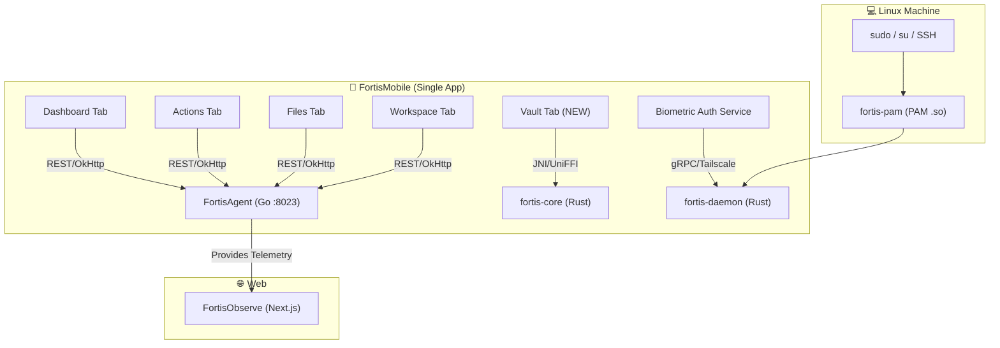

# Unified FortisMobile: Merging FortisEncrypt into the Existing Android App

## Analysis of the Existing Ecosystem

After a thorough exploration of `/home/ganeshak11/dev/Fortis-Ecosystem/`, here is the complete landscape:

| Project | Tech | What it Does | Status |
|---------|------|-------------|--------|
| **FortisMobile** | Kotlin / Jetpack Compose | Android control plane — Dashboard, telemetry, remote control, file transfer, terminal, webcam, media, clipboard, Bluetooth HID, notification sync, widgets | **Production-ready** (~80KB `MainActivity.kt`) |
| **FortisAgent** | Go | Linux daemon (REST API on `:8023`) — telemetry, actions, clipboard, terminal, file drop, webcam, input socket | **Production-ready** |
| **FortisBackup** | Bash / Rsync / Systemd | Automated air-gapped backup engine | **Production-ready** |
| **FortisObserve** | Next.js / TailwindCSS | Network-wide metrics dashboard (web) | **Production-ready** |
| **FortisLock** | React / Vite / TypeScript | Screen lock/dashboard (web) | **In progress** |
| **FortisEncrypt** | Rust / Tauri / Kotlin (UniFFI) | Password manager, TOTP, P2P sync, biometric sudo auth | **In progress** (our current work) |

### FortisMobile Architecture (the existing app)

```
com.example.fortismobile/
├── MainActivity.kt          # 1502 lines — ALL screens in one file (Compose)
├── MjpegServer.kt           # Webcam MJPEG streaming
├── FortisWidgetProvider.kt   # Home screen widget
├── FortisNotificationListener.kt  # Notification sync service
├── data/
│   ├── Device.kt             # Device data model
│   └── DeviceRepository.kt   # SharedPreferences-backed device store
├── domain/
│   ├── ActiveDeviceProvider.kt    # Singleton for active device state
│   └── CapabilityManager.kt      # Dynamic capability-based UI rendering
├── network/
│   ├── FortisApiClient.kt    # OkHttp REST client → FortisAgent
│   ├── AgentClient.kt        # Agent connection helper
│   ├── BluetoothHidManager.kt # Bluetooth HID keyboard/mouse
│   └── InputSocketClient.kt  # WebSocket remote input
└── ui/
    ├── FortisViewModel.kt    # ViewModel (devices, active device)
    ├── RemoteInputScreen.kt  # Remote trackpad/keyboard
    └── theme/                # Material 3 monochrome theme
```

**Key observations:**
- The app uses **Jetpack Compose** with **Material 3**
- Navigation: 4 bottom tabs → `Dashboard`, `Actions`, `Files`, `Workspace`
- All communication: **REST over Tailscale** to the Go agent
- Already has a **capability handshake system** — the UI dynamically renders based on what the connected agent supports
- Package: `com.example.fortismobile`
- The app already checks for Tailscale VPN connectivity (`ensureTailscaleActive`)

---

## The Decision: Single App vs. Two Apps

> [!IMPORTANT]
> **My strong recommendation: ONE app.** Here's why:

| Factor | One App | Two Apps |
|--------|---------|----------|
| User experience | Seamless — everything in one place | Constantly switching between apps |
| Tailscale connection | Shared — already managed | Duplicated logic |
| Biometric sudo | Natural — phone is already the control plane | Requires a second app running in background |
| Autofill service | Works from the same app | Another app to configure |
| Notification handling | Unified notification channels | Confusing duplicate notifications |
| Code sharing | `CapabilityManager` already supports dynamic features | None |
| Maintenance | One codebase, one APK | Two everything |

The existing FortisMobile already has the perfect architecture for this merge — its **capability-based dynamic UI** means we can add `"encrypt": true, "vault": true, "biometric_auth": true` to the capability handshake and the app will just render the new screens.

---

## Proposed Architecture: Unified FortisMobile

```
┌──────────────────────────────────────────────────────────────────────┐
│  FortisMobile (Unified Android App)                                  │
│                                                                      │
│  ┌──────────────────────────────────────────────────────────────┐    │
│  │  Bottom Navigation (Updated)                                 │    │
│  │                                                              │    │
│  │  Dashboard │ Actions │ Vault │ Files │ Workspace             │    │
│  │                       ▲                                      │    │
│  │                       └── NEW TAB                            │    │
│  └──────────────────────────────────────────────────────────────┘    │
│                                                                      │
│  ┌────────────────────┐  ┌────────────────────┐                      │
│  │  Existing Modules  │  │  New Encrypt Module │                     │
│  │                    │  │  (fortis-bindings)  │                     │
│  │  • Telemetry       │  │                    │                      │
│  │  • Remote Control  │  │  • Vault Browser   │                      │
│  │  • File Manager    │  │  • TOTP Codes      │                      │
│  │  • Terminal        │  │  • Password Gen    │                      │
│  │  • Webcam          │  │  • Biometric Auth  │                      │
│  │  • Bluetooth HID   │  │  • Autofill Svc    │                      │
│  │  • Notifications   │  │  • Device Pairing  │                      │
│  │                    │  │                    │                      │
│  │  via REST/OkHttp   │  │  via JNI/UniFFI   │                      │
│  │  → FortisAgent(Go) │  │  → fortis-core(Rust)                     │
│  └────────────────────┘  └────────────────────┘                      │
│                                                                      │
│  ┌──────────────────────────────────────────────────────────────┐    │
│  │  Shared Services                                             │    │
│  │  • FortisAuthService (gRPC listener for biometric sudo)      │    │
│  │  • FortisAutofillService (OS-level autofill)                 │    │
│  │  • FortisNotificationListener (existing)                     │    │
│  │  • FortisWidgetProvider (existing + vault quick-access)      │    │
│  └──────────────────────────────────────────────────────────────┘    │
└──────────────────────────────────────────────────────────────────────┘
```

---

## Proposed Changes

### Component 1: Gradle Build System (FortisMobile)

#### [MODIFY] [build.gradle.kts](file:///home/ganeshak11/dev/Fortis-Ecosystem/FortisMobile/android/app/build.gradle.kts)
Add the Rust native library and new dependencies:

```kotlin
dependencies {
    // ... existing dependencies ...

    // FortisEncrypt - Rust native bindings via UniFFI
    implementation(fileTree(mapOf("dir" to "libs", "include" to listOf("*.jar"))))
    
    // Biometric Authentication
    implementation("androidx.biometric:biometric:1.2.0-alpha05")
    
    // gRPC (for biometric sudo challenge listener)
    implementation("io.grpc:grpc-okhttp:1.62.2")
    implementation("io.grpc:grpc-protobuf-lite:1.62.2")
    implementation("io.grpc:grpc-stub:1.62.2")
}

android {
    // ... existing config ...
    
    // Tell Gradle where to find the native .so libraries
    sourceSets {
        getByName("main") {
            jniLibs.srcDirs("src/main/jniLibs")
        }
    }
}
```

We'll place the compiled `libfortis_bindings.so` (from our Rust cross-compilation) into `app/src/main/jniLibs/arm64-v8a/`.

---

### Component 2: New Package Structure

#### [NEW] `com.example.fortismobile.encrypt/` — Encrypt feature module

```
com/example/fortismobile/
├── encrypt/                          # NEW PACKAGE
│   ├── VaultScreen.kt                # Vault browser Composable (passwords, cards, notes)
│   ├── AuthenticatorScreen.kt        # TOTP codes with live countdown timer
│   ├── PasswordGeneratorScreen.kt    # Generate secure passwords
│   ├── BiometricPromptActivity.kt    # Transparent activity for sudo auth
│   ├── FortisAuthService.kt          # Foreground service: gRPC listener for sudo challenges
│   ├── FortisKeyManager.kt           # Android KeyStore Ed25519 keypair management
│   ├── FortisAutofillService.kt      # OS-level autofill (moved from FortisEncrypt)
│   └── PairDeviceScreen.kt           # Pairing ceremony UI
├── data/
│   ├── Device.kt                     # (existing, unchanged)
│   └── DeviceRepository.kt           # (existing, unchanged)
└── ...
```

The generated UniFFI bindings file (`fortis_bindings.kt`) goes into:
```
com/example/fortismobile/uniffi/fortis_bindings/fortis_bindings.kt
```

---

### Component 3: Navigation Update

#### [MODIFY] [MainActivity.kt](file:///home/ganeshak11/dev/Fortis-Ecosystem/FortisMobile/android/app/src/main/java/com/example/fortismobile/MainActivity.kt)

The existing navigation structure on **line 68**:
```kotlin
val tabs = listOf("Dashboard", "Actions", "Files", "Workspace")
```

Changes to:
```kotlin
val tabs = listOf("Dashboard", "Actions", "Vault", "Files", "Workspace")
```

And the `when` block on **line 119** adds:
```kotlin
when (selectedTab) {
    0 -> DashboardScreen(...)
    1 -> ActionsScreen(...)
    2 -> VaultScreen()          // NEW — The Encrypt vault browser
    3 -> FileManagerScreen()
    4 -> WorkspaceScreen(...)
}
```

This is a **minimal change** to the existing 1502-line file. We add one tab and one composable route.

---

### Component 4: Vault Screen (The Main Encrypt UI)

#### [NEW] [VaultScreen.kt](file:///home/ganeshak11/dev/Fortis-Ecosystem/FortisMobile/android/app/src/main/java/com/example/fortismobile/encrypt/VaultScreen.kt)

A Jetpack Compose screen that matches the app's existing **True Monochrome** design language:

```kotlin
@Composable
fun VaultScreen() {
    // Sub-navigation within the Vault tab:
    // - Passwords (default)
    // - Authenticator (TOTP)
    // - Generator
    // - Pair Device
    
    // Uses UniFFI bindings to call Rust:
    // - uniffi.fortis_bindings.getTotp(secret) → live TOTP code
    // - uniffi.fortis_bindings.generateSecurePassword(length) → password
    
    // Loads vault data from the local SQLite DB via Rust core
    // (or synced via P2P from the Linux daemon)
}
```

The monochrome aesthetic will be maintained: black background, white text, monospace font, flat cards with thin borders. This matches the existing screens perfectly.

---

### Component 5: AndroidManifest.xml Updates

#### [MODIFY] [AndroidManifest.xml](file:///home/ganeshak11/dev/Fortis-Ecosystem/FortisMobile/android/app/src/main/AndroidManifest.xml)

Add to permissions:
```xml
<uses-permission android:name="android.permission.USE_BIOMETRIC" />
```

Add to `<application>`:
```xml
<!-- Autofill Service (password filling in other apps) -->
<service
    android:name=".encrypt.FortisAutofillService"
    android:permission="android.permission.BIND_AUTOFILL_SERVICE"
    android:exported="true">
    <intent-filter>
        <action android:name="android.service.autofill.AutofillService" />
    </intent-filter>
</service>

<!-- Biometric Auth Listener (for sudo approval) -->
<service
    android:name=".encrypt.FortisAuthService"
    android:foregroundServiceType="connectedDevice"
    android:exported="false" />

<!-- Transparent Biometric Prompt Activity -->
<activity
    android:name=".encrypt.BiometricPromptActivity"
    android:theme="@android:style/Theme.Translucent.NoTitleBar"
    android:excludeFromRecents="true" />
```

---

### Component 6: Capability Handshake Extension

#### [MODIFY] [CapabilityManager.kt](file:///home/ganeshak11/dev/Fortis-Ecosystem/FortisMobile/android/app/src/main/java/com/example/fortismobile/domain/CapabilityManager.kt)

The existing `CapabilityManager` dynamically renders UI based on what capabilities the connected FortisAgent reports. We extend this to support local-only capabilities:

```kotlin
object CapabilityManager {
    // Existing: agent-reported capabilities (remote)
    fun getCapabilities(device: Device?): Map<String, Boolean> { ... }
    
    // NEW: local device capabilities (always available regardless of connected agent)
    fun getLocalCapabilities(): Map<String, Boolean> {
        return mapOf(
            "vault" to true,           // Password vault always available
            "authenticator" to true,    // TOTP always available
            "biometric_auth" to true,   // Biometric sudo if paired
            "autofill" to true          // Autofill always available
        )
    }
}
```

This is brilliant because the Vault tab works even when **no device is connected** — it's a local feature. The existing FortisMobile architecture already supports this pattern since the `DevicesScreen` (no active device) and the tabbed interface (active device) are separate flows.

---

### Component 7: What Happens to `FortisEncrypt/fortis-android/`

> [!IMPORTANT]
> **We delete `FortisEncrypt/fortis-android/` entirely.** Its code migrates into FortisMobile under the `encrypt/` package. The skeleton files we created there (`MainActivity.kt`, `FortisAutofillService.kt`, `AndroidManifest.xml`) were scaffolds — the real implementation lives in FortisMobile.

The Rust side (`fortis-bindings`, `fortis-core`, `fortis-pam`, etc.) stays exactly where it is in `FortisEncrypt/`. Only the Android code moves.

---

## What Stays in FortisEncrypt vs. What Moves

| Component | Location | Stays / Moves |
|-----------|----------|--------------|
| `fortis-core` (Rust crypto/DB) | `FortisEncrypt/fortis-core/` | **Stays** |
| `fortis-sync` (gRPC P2P) | `FortisEncrypt/fortis-sync/` | **Stays** |
| `fortis-daemon` (Linux service) | `FortisEncrypt/fortis-daemon/` | **Stays** |
| `fortis-cli` (Terminal client) | `FortisEncrypt/fortis-cli/` | **Stays** |
| `fortis-desktop` (Tauri UI) | `FortisEncrypt/fortis-desktop/` | **Stays** |
| `fortis-bindings` (UniFFI bridge) | `FortisEncrypt/fortis-bindings/` | **Stays** (generates `.so` + `.kt`) |
| `fortis-pam` (PAM module) | `FortisEncrypt/fortis-pam/` | **Stays** (new, Phase 6) |
| `fortis-android` (standalone app) | `FortisEncrypt/fortis-android/` | **DELETED** — migrates to FortisMobile |

---

## Implementation Order

| Step | Where | Task | Effort |
|------|-------|------|--------|
| 1 | `FortisEncrypt/fortis-bindings` | Cross-compile `libfortis_bindings.so` for `aarch64-linux-android` | Medium |
| 2 | `FortisMobile/android/app/build.gradle.kts` | Add biometric, gRPC, JNI dependencies | Low |
| 3 | `FortisMobile/android/app/src/main/jniLibs/` | Copy the compiled `.so` and generated `.kt` bindings | Low |
| 4 | `FortisMobile/.../encrypt/VaultScreen.kt` | Build the Vault browser screen (monochrome Compose) | Medium |
| 5 | `FortisMobile/.../encrypt/AuthenticatorScreen.kt` | Build the TOTP screen with live countdown | Medium |
| 6 | `FortisMobile/.../encrypt/PasswordGeneratorScreen.kt` | Build the generator screen | Low |
| 7 | `FortisMobile/.../MainActivity.kt` | Add "Vault" tab to navigation | Low |
| 8 | `FortisMobile/.../encrypt/FortisAutofillService.kt` | Implement the OS-level autofill service | Medium |
| 9 | `FortisMobile/.../encrypt/FortisKeyManager.kt` | Ed25519 keypair in Android KeyStore | Medium |
| 10 | `FortisMobile/.../encrypt/BiometricPromptActivity.kt` | Fingerprint prompt for sudo auth | Medium |
| 11 | `FortisMobile/.../encrypt/FortisAuthService.kt` | gRPC listener for incoming sudo challenges | Medium |
| 12 | `FortisMobile/.../encrypt/PairDeviceScreen.kt` | Pairing ceremony UI | Low |
| 13 | `FortisMobile/AndroidManifest.xml` | Register new services and permissions | Low |
| 14 | `FortisEncrypt/fortis-android/` | **Delete** — code has been migrated | Low |

---

## Final Unified Architecture



---

## Verification Plan

### Automated Tests
```bash
# Verify Rust bindings still compile
cd FortisEncrypt && cargo build -p fortis-bindings

# Verify the Android project builds
cd FortisMobile/android && ./gradlew assembleDebug
```

### Manual Verification
1. Install the unified APK on the phone
2. Verify existing features (Dashboard, Actions, Files, Workspace) still work
3. Open the new "Vault" tab — verify passwords and TOTP codes render
4. Test the biometric sudo flow end-to-end
5. Test the autofill service in Chrome on the phone
